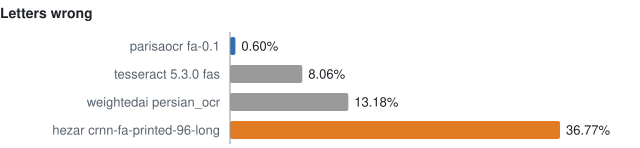
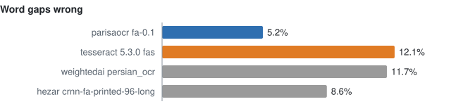
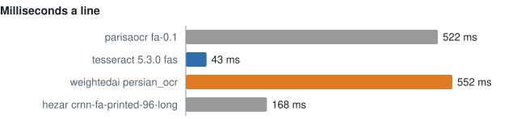
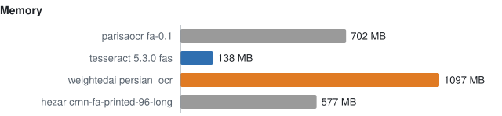

# Scorecard

Written by `make bench` from [`results.jsonl`](results.jsonl) after every run: don't edit by hand. What each number means: `src/rtlbook/bench.py` and docs/ROADMAP.md ("Reader slot and scorecard").

## Line readers on the same checked lines

Each reader reads the 109 checked test lines of `three-drops-1932-test-v1` (data `9f4d258f7368`) one line image at a time, cut by rtlbook. Letters wrong ignore spaces and half-spaces; word gaps wrong count only those. Fewer is better. Image size: rtlbook's own image for Tesseract `fas`, the readers image (all the other readers together) for the rest.

| Reader | Letters wrong | Lines all right | Word gaps wrong | Seconds a line | Memory, MB | Image, MB | Run |
|---|---|---|---|---|---|---|---|
| parisaocr fa-0.1 | 0.60% | 93 of 109 | 5.2% | 0.522 | 702 | 2736 | 2026-10-15, `v0.6.0-8-gc6bc59b-dirty` |
| tesseract 5.3.0 fas | 8.06% | 15 of 109 | 12.1% | 0.042 | 84 | 550 | 2026-10-15, `v0.6.0-13-g3a0fe71` |
| weightedai persian_ocr | 13.18% | 0 of 109 | 11.7% | 0.552 | 1097 | 2736 | 2026-10-15, `v0.6.0-8-gc6bc59b-dirty` |
| hezar crnn-fa-printed-96-long | 36.77% | 6 of 109 | 8.6% | 0.168 | 577 | 2736 | 2026-10-15, `v0.6.0-8-gc6bc59b-dirty` |

Fewer is better in all four: the best blue, the worst orange. The first two: how well each reads; the last two: what it costs to run, one CPU thread.

## Whole pages and an exported PDF, through `convert`

`convert`'s own OCR (Tesseract finds and reads the lines in one call, whatever the reader above).

| Case | Letters wrong | Word gaps wrong | More | Seconds a page |
|---|---|---|---|---|
| Pages 30, 54, 76 (68 lines) | 8.66% | 9.5% | lines lost or merged: 1, extra: 2, words split: 24 | 1.2 |
| Exported PDF, `tomorrow-2006.pdf` (11 pages) | 0.52% | 13.8% |  | 1.92 |

From the run of 2026-10-15 (`v0.6.0-13-g3a0fe71`, rtlbook 0.6.0).

## Every run

Newest first. Lines and pages compare only between runs on the same data.

| Date | Commit | rtlbook | Reader | Lines (data) | Letters wrong | Word gaps wrong | Pages, letters wrong | Exported, letters wrong |
|---|---|---|---|---|---|---|---|---|
| 2026-10-15 22:13 | `v0.6.0-13-g3a0fe71` | 0.6.0 | tesseract 5.3.0 fas | 109 (`9f4d258f7368`) | 8.06% | 12.1% | 8.66% | 0.52% |
| 2026-10-15 21:54 | `v0.6.0-11-g627b31a` | 0.6.0 | tesseract 5.3.0 fas | 109 (`9f4d258f7368`) | 8.06% | 12.1% | 8.44% | 0.52% |
| 2026-10-15 17:40 | `v0.6.0-8-gc6bc59b-dirty` | 0.6.0 | hezar crnn-fa-printed-96-long | 109 (`9f4d258f7368`) | 36.77% | 8.6% | 8.44% | 0.52% |
| 2026-10-15 17:39 | `v0.6.0-8-gc6bc59b-dirty` | 0.6.0 | weightedai persian_ocr | 109 (`9f4d258f7368`) | 13.18% | 11.7% | 8.44% | 0.52% |
| 2026-10-15 17:38 | `v0.6.0-8-gc6bc59b-dirty` | 0.6.0 | parisaocr fa-0.1 | 109 (`9f4d258f7368`) | 0.60% | 5.2% | 8.44% | 0.52% |
| 2026-10-15 17:37 | `v0.6.0-8-gc6bc59b-dirty` | 0.6.0 | tesseract 5.3.0 fas | 109 (`9f4d258f7368`) | 8.06% | 12.1% | 8.44% | 0.52% |
| 2026-10-15 02:14 | `v0.6.0-8-gc6bc59b-dirty` | 0.6.0 | parisaocr fa-0.1 | 54 (`4ad3d36463cd`) | 0.75% | 8.4% | 6.95% | 0.52% |
| 2026-10-15 02:13 | `v0.6.0-8-gc6bc59b-dirty` | 0.6.0 | hezar crnn-fa-printed-96-long | 54 (`4ad3d36463cd`) | 35.93% | 8.8% | 6.95% | 0.52% |
| 2026-10-15 02:12 | `v0.6.0-8-gc6bc59b-dirty` | 0.6.0 | weightedai persian_ocr | 54 (`4ad3d36463cd`) | 12.49% | 12.7% | 6.95% | 0.52% |
| 2026-10-15 00:19 | `v0.6.0-7-g6f0934f-dirty` | 0.6.0 | parisaocr fa-0.1 | 54 (`4ad3d36463cd`) | 0.75% | 8.4% | 6.95% | 0.52% |
| 2026-10-14 23:42 | `v0.6.0-4-g4b4bc28-dirty` | 0.6.0 | tesseract 5.3.0 fas | 54 (`4ad3d36463cd`) | 6.38% | 13.3% | 6.95% | 0.52% |
