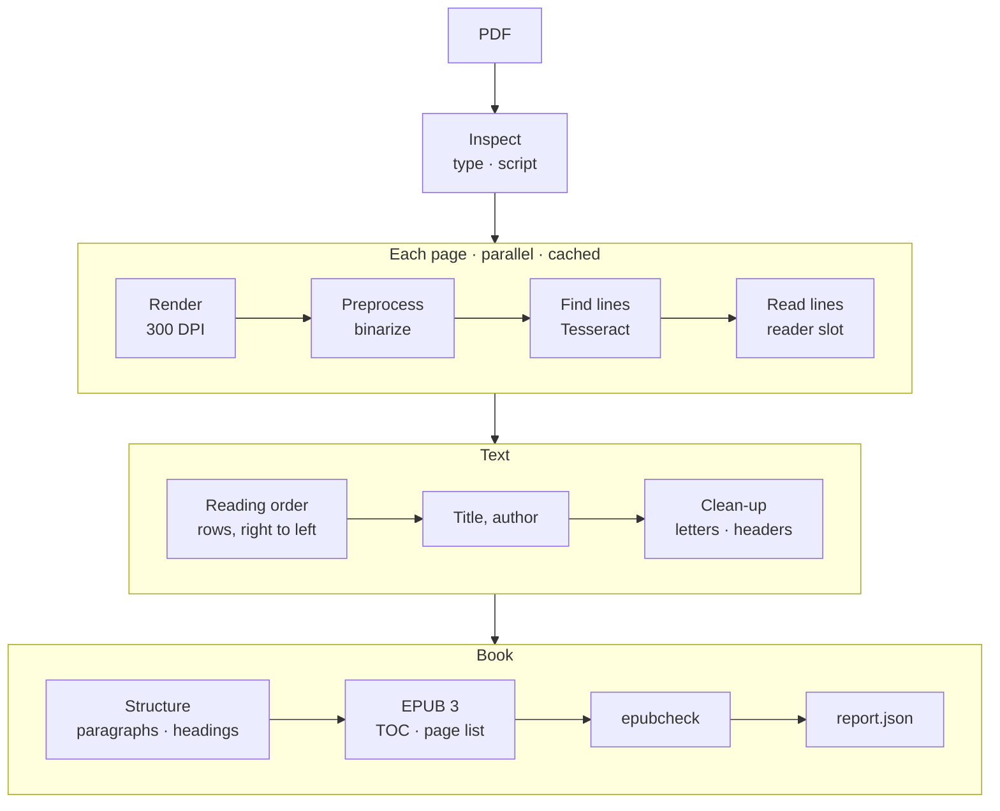

# RTL PDF → E-book Converter: Design

**Status:** early (rtlbook 0.5). Exported Persian PDFs convert end to end to EPUB 3; scans convert with more
errors and aren't supported yet. · **Updated:** 2026-10-08

> Each section says what is **built** and what was **dropped**; what's planned is in [ROADMAP.md](ROADMAP.md).
> The dated decisions and measurements behind it are in §11 (first prototype, 2026-09-24), §12 (2026-10-01 – 10-02) and §13
> (2026-10-08).

## 1. Goal

Take a PDF of a book written in a right-to-left (RTL) language and produce a clean, reflowable EPUB 3 that reads
correctly in reading systems built on Readium, such as Thorium Reader. Persian first; Arabic, Urdu and Hebrew later, as configuration where possible.

Support grows **one document type at a time**. Each type is finished, with measured accuracy, before the next:

| Type | What it is | Status |
|---|---|---|
| **Exported PDF** | Made by a word processor or layout tool: the PDF draws the text | **Supported** (phase 1) |
| **Scan of modern print** | Page images of a 1970s+ book | Converts; to be measured and supported (phase 3) |
| **Scan of old letterpress** | Page images of a 1900–1960s book | Converts with many errors; needs another engine (phase 4) |
| **Typewritten** | Uneven ink, broken letters | Later |
| Handwriting, lithographs (چاپ سنگی) | Calligraphy, not type | Out of scope |

The phases are in [ROADMAP.md](ROADMAP.md).

Content types follow the same idea: prose first, then verse (couplets), mixed prose and verse, heavy footnotes.

**Why OCR even for exported PDFs:** their stored text looks right on screen but rarely copies out right in
Persian: wrong character codes, words in reversed (visual) order, missing spaces, each PDF tool scrambling
differently. rtlbook therefore OCRs every page (§4.1, §12).

### Non-goals (for now)
- Keeping the exact visual layout (that's what the PDF is for). The output is reflowable text.
- Handwriting recognition.
- Complex tables, math, and multi-column magazine layouts.
- Formats other than EPUB, and converting the EPUB for a device (Kindle, Kobo): other tools do that (§13).

---

## 2. Output formats

| Format | Status | Notes |
|---|---|---|
| **EPUB 3** | **Built** | `page-progression-direction="rtl"`, `dir`/`lang` on every document, embedded Parastoo font, cover, chapter TOC and print page list. Made for Readium-based reading systems (Thorium). The only output. |
| KFX (Kindle) | Dropped | Built 2026-09-24 – 10-08 (Kindle Previewer + calibre's KFX Output plugin); device formats are out of scope (§13). |
| AZW3 | Dropped | Tested on a Kindle: renders Persian with heavy lag (§11). |

---

## 3. Pipeline



Tesseract finds the lines. In a scan it finds them by layout analysis alone, and each line is then cut from the page
and read alone by a line reader, the reader slot (`readers.py`; ParisaOCR's model by default); in an exported PDF
finding and reading stay one Tesseract call (§4.5). The
scorecard (§4.10) scores the readers on checked lines.

Each page's OCR result is cached in the book's work folder (`output/<name>.rtlbook/pages/`), keyed by the OCR
settings. Re-running with other text or EPUB options takes seconds. Pages are OCR'd in parallel.

---

## 4. Stage details

### 4.1 Inspect: document type — built
`inspect` reports whether a PDF is an **exported PDF** (supported) or a **scan** (page images; converts, not
supported yet), with the scan resolution. A page counts as a scan if images cover most of it, or a good part of it
while the text layer holds almost no Persian letters (scanned strips pasted into Word, or a scan with an English
header). `convert` prints the same verdict and warns on scans. Correct on all 10 test PDFs.

**Script check — built.** Before OCR, Tesseract's orientation and script detection (OSD, `--psm 0`, the `osd`
model) looks at up to six pages picked at random from the body of the book (not the first or last tenth; the same
book always gets the same pages) until three answer, and takes the majority (`script.py`). If the book is in another
script than the OCR language's (Latin for `fas`), `convert` says so, in the `start` event too (`script`,
`script_expected`), and goes on; a program running it can stop it there. OSD reads the page images, so it works on
scans and garbled text layers alike, in about 0.5 s a page. It names scripts, not languages: Persian, Arabic and
Urdu are all Arabic. Its confidence number varies too much to use (2 to 260 on clean pages), so only the names
count. Correct on all 18 Persian test PDFs (7 of them scans) and on test pages in 11 scripts (Latin, Cyrillic,
Arabic in three styles including Nastaliq, Hebrew, Han, Devanagari, Thai; sideways and upside-down pages too).

*Dropped:* a text-layer route that read the PDF's own text when quality checks passed (presentation forms,
visual-order detection, garbage ratio, common-word score). None of 11 exported Persian PDFs had a text layer
usable as is; rebuilding it needed rules per PDF tool, while OCR misread about 0.5% of letters (§12).

### 4.2 Rendering — built
- Pages render at **300 DPI** with `pypdfium2` (permissive license). 400 DPI was slower with no gain (§11).
- *Dropped (2026-10-06), to keep the input simple:* a folder of page images instead of a PDF (PNG, JPEG, TIFF,
  JP2, e.g. an unpacked Internet Archive JP2 ZIP). Scans still convert when they come as a PDF. Worth bringing back
  for scans ([ROADMAP.md](ROADMAP.md)).

### 4.3 Image preprocessing — built
Grayscale and **Otsu binarization** (essential for tinted page backgrounds), optional edge crop for framed pages.

### 4.4 Layout and reading order — built for single-column pages and two-column verse
- Tesseract runs in **single-column mode (`--psm 4`)**. Its automatic layout (`--psm 3`) silently dropped lines set
  in larger type.
- In that mode two-column verse comes back as one line. Lines are **split at wide word gaps that line up across
  the page** (wide spaces in prose fall at random places, so prose is left alone).
- Lines that sit **side by side are read as one row**, rows top to bottom, each row right to left, so a couplet's
  two half-lines stay together.
- **Running headers, footers and watermarks** repeated in the top/bottom 15% of many pages are removed, including
  OCR variants of them (a misread letter, or only part of the header).

### 4.5 OCR engines and accuracy
- **Built:** Tesseract 5 with `tessdata_best` (`fas`). About 1–2 s per page per core for an exported PDF.
- **The reader slot** (2026-10-15, `--reader`, default `auto`): in a scan, Tesseract's layout analysis finds the
  lines on the binarized page without reading them (0.16 s a page, a sixth of a whole-page reading), and each line is
  cut from the unbinarized page (8 pixels above and below, 12 at the ends, at 300 dpi) and read alone as a raw line
  (`--psm 13`, binarized on its own). Both go through Tesseract's C API (`ocr.layout_words`, `ocr.read_line`, ctypes,
  nothing added to the image): the model loads once per process, and a line reads in 25 ms instead of 43 by the
  command line, with the same text. On the 1932 book's checked pages 8.7% → 5.8% letters wrong, word gaps 9.5% →
  8.9%, 1.0 s a page instead of 1.2; the whole book keeps 2% more letters. The padding was chosen on 531 checked
  training lines (6–8 pixels best for layout boxes, which leave out some marks above and below; padding in proportion
  to each line's height was worse, it gives tall lines too much); the 68 lines of the test pages alone would have
  chosen differently on every try. "Lines" under 12 pixels (specks) or over 400 (pictures) are skipped, and so is a
  line read as nothing. An exported PDF gains nothing from cut lines (0.52% either way), so `auto` reads its whole
  pages in one call (`--reader page`). The reader joins the cache key.
- **ParisaOCR reads a scan's lines** (2026-10-16, `--reader auto`; `--scan-reader tesseract` for Tesseract on scans
  only, exported PDFs keeping the whole-page call; `--reader tesseract` cuts every PDF's lines): ParisaOCR's
  recognizer (Apache-2.0, ParisaOCR 0.7.2: PaddleOCR's PP-OCRv6 design trained with Kraken on Persian print, 3.0M
  weights, lines 96 pixels high). On the 1932 book's checked pages 5.8% → 0.32% letters wrong, word gaps 8.9% → 4.0%,
  no line lost (2 before); about 5.6 s a page on one thread instead of 1.0 (the whole book on 8 cores: 3.6 minutes
  instead of half a minute). Exported PDFs keep Tesseract: ParisaOCR reads them barely better (0.44% against 0.52%)
  at six times the time. Old and modern type alike: on two pages each of a 1963 printing and three modern editions
  (2002, 2004 and a Masnavi), where the two readers disagreed a person judged the lines blind, and ParisaOCR was
  right or closer on 71 of the 73 they could decide.
  - *No PyTorch:* a build stage exports the model to ONNX (`docker/parisaocr_onnx.py`); the image runs it with ONNX
    Runtime and numpy (image 550 → 675 MB, a 12 MB model). `readers.ParisaOCR` redoes Kraken's steps for a line
    (grey to colour, 96 high, 16 white columns at each end, inverted, greedy CTC decoding) and ParisaOCR's (its
    placeholder for ZWNJ, display order to reading order with Kraken's bidi algorithm, copied as `rtlbook.bidi`, a
    line with more Latin than Arabic-script letters left to right, its clean-up of each word). The same text as
    ParisaOCR's own reader on all 118 test lines, and the same confidences.
  - *Its name* (2026-10-21) is in the ONNX file's metadata, written by the export, so a fine-tuned model
    exported the same way (`parisaocr_onnx.py OUT_DIR MODEL NAME`, read from `RTLBOOK_MODELS`) is named as itself in
    every result, `rtlbook:read-by` included, and keeps it wherever the file goes; a file without one is the stock
    model, `parisaocr fa-0.1 onnx`.
  - *The padding, computed once:* the model was trained on lines padded on the right to 2560 columns, and its five
    squeeze-and-excitation blocks average each channel over that whole width; with less padding it reads badly
    (2048 columns: 0.68% → 18% letters wrong on 531 checked training lines). Lines are 1000–1500 columns wide at 96
    pixels, so the padding was most of the time. Deep in the padding every column is the same, so the exported model
    runs the line with a margin of 128 white columns and adds the rest of the padding to each average by
    calculation: the same characters on all 531 lines (64 columns of margin were too few), 2.2 times faster. Quantized
    to 8 bits it would be 1.8 times faster again, but with 0.91% letters wrong instead of 0.71%: not used.
  - *One confidence scale:* ParisaOCR's confidence (its letters' probabilities, averaged by word, then by line)
    crowds near 100: on the training lines, its lines below 96 have 12% or more letters wrong, as Tesseract's do below
    70, and from 98 up almost none. `convert`'s thresholds are tuned to Tesseract (the low-confidence warning, pages
    below 80, headings at 60, stray marks, `--min-line-conf`), so the reader puts its confidence on Tesseract's scale:
    100 − 10 × (100 − c), so 95 → 50, 97 → 70, 99 → 90. The 1932 book then averages 86: no low-confidence warning,
    rightly (with Tesseract, 64).
- **Measured** with `rtlbook eval` (character and word error rates against a checked text; spelling conventions
  such as ي/ی, digits, half-spaces and vowel marks count as equal):

| Material | Tesseract | Kraken (OpenITI Persian) | AI vision |
|---|---|---|---|
| Exported PDF (a 1946 story) | **0.8%** letters wrong (~0.5% real misreads) | — | — |
| 1932 letterpress | 6–8% | **1.9%** | — |
| 1960s poetry print | **6–12%** | 20–30% | — |
| Two-column verse, narrow gutter | ~46% of words found | ~77% | **~89%**, layout handled |

Measured before the scorecard. ParisaOCR (on the line above, 0.32% on the 1932 book's checked pages) is in the
pipeline for scans; the Kraken model and AI vision in this table were only measured in experiments.

### 4.6 Document model — built
```
Page:      number, width, height, settings (OCR cache key), lines[]
Line:      text, bbox (pixels on the rendered page), confidence
Paragraph: segments (text, plus markers where a printed page starts), heading flag
Section:   title, paragraphs[]  → one XHTML file in the EPUB
```

### 4.7 Text clean-up — built
- A warning when a book's mean OCR confidence is below 70 (exported PDFs score 80–87; a decorative
  font scored ~55), in `report.json` and the `done` event.
- Arabic `ي`/`ك` → Persian `ی`/`ک`; tatweel removed; Persian digits by default (`--digits`); the Persian
  comma misread as `»` (a `»` with no open `«` in its paragraph) or as a word-final `ء`; mirrored parentheses;
  OCR debris lines; dropping lines by regex (`--drop-lines`) or below a confidence (`--min-line-conf`).
- **Marks against their words** (2026-10-19, `text.close_marks`): no space before `. ؛ : ؟ ! »`, none after `«`,
  within a line and across a line break. Old type often sets a gap before a mark, and OCR (and readers) copy it; in an
  EPUB it reads as a stray space, and a reading system can break the line there, leaving the mark alone at the start
  of the next. The training rules type it the same way (TRAINING-DATA.md, rule 3, version 3).
- **Joined words** (Farsi scans, `joined.py`; `--no-split-joined` turns it off): in old type the gap after a letter
  that never joins the next (ا د ذ ر ز ژ و) can be a hair wide, and Tesseract reads two words as one. A word no word
  list knows is split, only after such a letter, into the fewest known pieces: three letters or more from the
  everyday list or the book's own words seen three times or more, or one of a few short words (و از در با را…); an
  ending (ها، ترین، شان…) never stands alone, and a word in the large list is never split. The lists are built into
  the image: Tesseract's own Farsi word list (13,892 words, unpacked from `fas.traineddata`) and Lilak's (85,838
  words, Apache-2.0, a pinned commit). On the 1932 book's whole test pages, word gaps wrong 11.5% → 9.5%, letters
  untouched (24 splits: 15 right, none wrong, the rest inside words already misread); 815 words split in the book, in
  0.1 s. Exported
  PDFs are left alone: there a missing space after such a letter barely shows, while a wrong split visibly breaks a
  word. On the exported story, whose typist often left those spaces out, about 27 of 37 splits were right by the
  spacing rule, and about 10 broke words the lists lack (colloquial forms, a compound, a name).
- **Half-spaces** (Farsi, every document; `halfspace.py`, `--no-half-spaces` turns it off), after joined words are
  split: readers mostly write a full space where today's spelling has a half-space (ZWNJ), and older type often
  sets one there with a visible gap. In an EPUB that space lets a line break inside the word and breaks search,
  look-up and read-aloud, so five patterns get a half-space: the plural ها and its forms, تر/ترین, the endings
  ام/ای/اش/ایم/اید/اند after a silent ه, and the prefixes می/نمی and بی (a prefix only as a word on its own, so
  بی‌بی خانم stays two words). An editing choice, not a reading fix: it follows today's spelling over the print,
  so it isn't scored against checked lines, which keep the printed gaps (the scorecard leaves it out; on the 1932
  test pages it made 15, all where the type has a gap). On a 1963 printing read by ParisaOCR, against a proofread transcription: 258 half-spaces, 238 as
  the transcription has them; lines agreeing 55.9% → 61.7%, 2 lines made worse. Compound words are left alone
  (about 750 more pairs there: which compounds take a half-space is word knowledge, and spellings differ; a large
  word list joined 583 pairs, 261 of them wrongly). On the exported story, 11 in the whole book.
- **Paragraphs:** rebuilt from line position (does the line reach the left margin?), sentence-final punctuation,
  dialogue markers (`Name- …`) and vertical gaps, and joined across page breaks. Lines join with a space, except a
  verb broken after its prefix (a line ending in `می-` or `نمی-`): the dash goes and a half-space joins the two, as
  the prefix is written inside a line.
- Text is stored in logical order; the reader's bidi algorithm handles display. No RLM/LRM sprinkling.

### 4.8 Structure — built
- Chapter headings of three kinds: `فصل` + ordinal, tolerant of OCR errors (edit distance); a short
  line in **large type** (≥ 1.6× the book's line height, with big letters rather than two merged lines, and OCR
  confidence ≥ 60); a short **numbered title** with space above it (`۲ـ غلام`; a lone `۱` misread as `ا` is
  fixed). A wrapped large-type title stays one heading. Books without headings are split into ~20-page sections; cover from the first page image; EPUB page list from the PDF pages.
- Title, credits and contents pages (far fewer words than a typical page) keep each line separate
  and don't run into the text.
- Title and author from the title page: a `نام کتاب :` / `نویسنده :` label, else the line right above
  the author line, else the topmost large-type line (a pen name such as `م. مودب‌پور` is the author, not the title);
  credit lines (typist, converter, website, publisher) are skipped and PDF metadata is ignored (usually wrong). `convert`
  reports what it found and where from.
- The book's contents page (a sparse page with 4+ numbered lines) corrects chapter headings OCR'd
  worse than their entry, and turns a short standalone line matching an entry into a heading.

### 4.9 EPUB 3 builder — built
Written directly (a ZIP of XHTML, CSS and an OPF manifest), keeping full control of RTL details and avoiding
AGPL dependencies. One XHTML file per section, `nav.xhtml` with TOC and page list plus `toc.ncx`, the
Parastoo font (OFL, a book typeface) embedded by default (`--no-embed-font` to leave it to the reader).
The package says how the book was made (2026-10-16), the same facts as `report.json`'s `engine`, under a declared
`rtlbook:` prefix: `rtlbook:version`, `rtlbook:document` (scan or exported), `rtlbook:lines-found-by` and
`rtlbook:read-by`, readers' names with their versions. A copy that comes back to its maker, separated from its
records, still tells which engine and readers made it. Reading apps don't show these; epubcheck accepts them.

### 4.10 Validation — built
- **epubcheck** on every build; any error fails `convert`.
- **Accuracy:** `rtlbook eval` against checked text, and `tests/test_ground_truth.py`, which fails if accuracy on
  the public-domain pages in `tests/data/` drops below the baseline.
- **Scorecard:** `rtlbook bench` (`make bench SET=<a training set's folder>`) scores a line reader (`readers.py`)
  on a set's checked test lines read one by one, whole pages through `convert`'s OCR and joined-word splitting (the
  set's test pages whose every line is decided: older page texts don't follow its spacing rules), and
  an exported PDF, with spacing (word gaps) counted apart from letters and the speed and memory; each run is added to `bench/results.jsonl` and
  compared with the last. Lines and pages compare only between runs on the same checked data. `bench/README.md` shows
  the readers side by side, with bar charts it draws itself as SVG (`bench/charts/`: Mermaid's bars start before
  their axis's zero). Tesseract and ParisaOCR are in rtlbook's image; the other readers run in their own
  (`make readers`).

---

### 4.11 Building from a checked set — built
- **`convert --lines SET`** (`fromset.py`) builds a book from a checked set of lines (docs/TRAINING-DATA.md) instead
  of OCR: each line keeps its box on the page and takes the set's text: a checked line's `.gt.txt`, else the text two
  independent readings agreed on (`.agreed.txt`), else an unsure line's best guess; skipped lines are left out, and a
  line nobody decided keeps its OCR. A frozen version's manifest, beside `lines.json` as `manifest.json`, has the last
  word on each status (it holds what freezing decided, such as a line skipped by agreement). Everything after reading
  runs as for OCR (reading order, page numbers and running titles, paragraphs, chapters, half-spaces), except the
  joined-word split: checked text keeps the book's gaps. `report.json` counts the lines by source
  (`lines_from_set`), and the engine block names the set. A 153-page book (1932 letterpress) builds in about 4 s.
- **An edition** (`--edition FILE`, JSON, with `--lines`) says what the lines can't: which lines start chapters
  (`chapters`: line ids; a title set in body type isn't found by layout, and a contents page's numbers are cut off as
  page numbers before it's read), which lines to leave out (`drop`: ids or patterns, such as the printed title and
  contents pages), the title and author, and editorial changes to the text (`replace`: regex patterns and what each
  becomes, applied to each line, such as an old typesetting of dialogue shown the way books set it today; 2026-10-19).
  A line marked as a chapter start becomes a heading as it is; a chapter can also bring its title (`title`), a heading
  just before its line, where the printed title isn't a usable line (cut in two, or never cut). `"quotes": "paired"`
  keeps only quotes that open and close in one paragraph, for old typesetting that repeats « at the start of every
  line of a long quotation. The set keeps the text as printed: an edition only changes the book.
- **Checked text is trusted** (2026-10-19): with `--lines`, the fixes for what OCR misreads are off (a » with no «
  before it in its paragraph is a real one, not a comma read wrong; no mirrored parentheses to turn), and a dialogue
  line starts a paragraph only after a sentence's end or a colon, so a turn opened mid-sentence at a line break stays
  in it. Unsure lines' text goes into the book (their print, where a crop held two lines or cut one).
- **Covers:** a cover is the page's largest image, or, when that covers less than most of the area all its images
  cover (a scan stored in strips), that whole area cut from the page rendered in colour; the cover page holds it in
  an SVG box the page's height, so it's scaled to fit whatever space a reading system gives it (an `` alone
  showed at full width, cut off below). `--no-cover` leaves cover and cover page out.

## 5. CLI

Runs in Docker through the `./rtlbook` wrapper, which only shares the repository folder with the container.

```bash
./rtlbook inspect input/book.pdf                       # exported PDF or scan? right script?
./rtlbook convert input/book.pdf --title "…" --author "…"   # → output/book.epub
./rtlbook eval output/book.rtlbook ref.txt --pages 24  # accuracy against a checked text
./rtlbook lines input/book.pdf --pages 12-40 --split train --out lines/book --common words.txt  # training lines (docs/TRAINING-DATA.md)
```

Main `convert` options: `--pages`, `-j/--jobs`, `--drop-lines REGEX`, `--min-line-conf`, `--crop`, `--digits`,
`--cover`, `--psm`, `--dpi`, `-o`, `--work`. Full list in the README.

*Dropped from the original plan:* `bench` (replaced by `eval`), and separate `ocr`/`review`/`build` steps (not
needed while each book is one `convert` with a page cache).

---

## 6. Review page — prototype

A local page for a person to settle what the engine can't: for each uncertain spot, a crop of the scan line, the
candidate readings as buttons, and a box to type the right text. A "save" button writes the decisions to a JSON
file, which a script applies to the text. A prototype was used to check OCR ground truth against scans: far quicker and more reliable than correcting OCR
text by eye.

---

## 7. Repository layout

```
rtlbook/
├─ rtlbook                   # wrapper: runs the CLI in Docker
├─ docker/Dockerfile         # Tesseract, ParisaOCR's model (made by parisaocr_onnx.py), epubcheck, fonts, word lists
├─ src/rtlbook/
│  ├─ cli.py                 # Typer commands: init, inspect, convert, eval
│  ├─ doctype.py             # exported PDF or scan
│  ├─ script.py              # script check: Tesseract OSD on a few random pages
│  ├─ pdf.py                 # PDFs: rendering, page info, cover image
│  ├─ preprocess.py          # binarize, crop
│  ├─ ocr.py                 # Tesseract, line boxes, column-gap splitting
│  ├─ readers.py             # line readers: ParisaOCR, Tesseract, and the scorecard's others
│  ├─ bidi/                  # the Unicode bidi algorithm (Kraken's), for ParisaOCR's output
│  ├─ pipeline.py            # parallel OCR with a per-page cache; sections
│  ├─ layout.py              # reading order (rows, right to left)
│  ├─ text.py                # normalization, OCR fixes, headers/footers, paragraphs
│  ├─ headings.py            # chapter headings
│  ├─ model.py               # Page, Line, Paragraph, Section
│  ├─ epub.py                # EPUB 3 writer
│  ├─ evaluate.py            # accuracy against a checked text
│  └─ validate.py            # epubcheck
├─ tests/                    # unit tests; tests/data/ = public-domain ground truth
├─ docs/                     # DESIGN.md (this file), ROADMAP.md (phases, planned work), LESSONS.md (troubleshooting)
├─ input/                    # PDFs to convert (git-ignored)
└─ output/                   # EPUBs, per-book OCR caches, experiment notes (git-ignored)
```

---

## 8. Phases

Moved to [ROADMAP.md](ROADMAP.md).

---

## 9. Risks and decisions

- **Licenses:** no AGPL dependencies (PyMuPDF and `ebooklib` avoided).
- **Privacy and copyright:** books may be copyrighted or private. Everything runs locally; the container only sees
  the repository folder. Outside services (AI vision) only ever opt-in. Book text is never committed, except
  public-domain test pages.
- **AI vision** can produce fluent but wrong text. Use it with an independent engine and review disagreements.

### Questions answered
1. Languages: **Persian first.**
2. E-readers: **EPUB 3 for Readium-based reading systems (Thorium)**; device formats out of scope (§13; KFX
   for Kindle until 2026-10-08).
3. **A local tool.**
4. Cloud OCR / AI: **opt-in only**; not used yet.
5. GPU: **none** (Apple Silicon CPU). Tesseract runs on CPU.
6. Typewriter books: **none found yet.**

---

## 10. Key tools and references
- OCR: Tesseract 5 + `tessdata_best` (`fas`, `ara`; `osd` for the script check)
- PDF and images: pypdfium2, Pillow
- E-book: EPUB 3.3 (W3C), epubcheck; reading systems: Readium, Thorium Reader
- Font: Parastoo (OFL); Vazirmatn until 2026-10-05

---

## 11. Decisions and POC results (2026-09-24)

**Decisions**
- **Runtime: Docker.** One image (`docker/Dockerfile`) with Tesseract 5 and `tessdata_best` (fas, ara, and osd for the script check), epubcheck 5.1, Java, the Parastoo font, and Python deps via uv. The `./rtlbook` wrapper runs the CLI with the current directory mounted.
- **First language: Persian.**
- **Kindle output: KFX, built locally** (dropped 2026-10-08, §13). Tested on the device: AZW3 (Calibre) renders Persian with heavy lag and multiple refreshes. KFX is much faster and has Persian reflow and real page numbers. The pipeline: EPUB (container) → **Kindle Previewer 4 on the Mac** (EPUB→KPF, macOS/Windows only) → calibre **KFX Output** plugin in the container (KPF→KFX). Run it with `./rtlbook kfx book.epub`. Nothing is uploaded to Amazon.
- **Digits:** Persian ۰–۹ by default for Persian books (`--digits`).
- **PDF library: pypdfium2.** **EPUB writer: our own** (§4.9). No AGPL dependencies.

**POC book:** *Parichehr* (پریچهر), 472 pages, exported from Word 2007.
- The text layer is **completely garbled** (a broken glyph→Unicode map). `inspect` detected this on every page (function-word score 0.009) and sent the pages to OCR. This confirmed §4.1: a born-digital PDF can't be trusted as-is. (That text-layer check was later removed: every page is OCR'd, §12.)
- **OCR:** Tesseract `fas` at 300 DPI, **binarized first**, which was essential because the tinted page background broke some lines. The full book took **~2 minutes** on an M2 (8 workers), with 86.8% mean confidence. 400 DPI didn't help.
- **Font-specific OCR quirks:** the Persian comma is read as `»`/`ء`, and closing parentheses come out mirrored. Both are fixed in post-processing, gated on book-level detection so books that OCR correctly aren't changed.
- **Paragraph rebuilding:** uses dialogue markers (`Name- …`), sentence-final punctuation, full-width lines (the RTL line end reaches the left margin), and large vertical gaps. Paragraphs join across page breaks.
- **Output:** a valid EPUB 3.3 (epubcheck: 0 errors, 0 warnings) with RTL page progression, the embedded font, a cover, and a print page list.

**Batch of 8 novels (3,231 pages).** All 8 converted to valid EPUB and KFX, about 13 minutes of OCR in total.
- **Not one had a usable text layer.** 3 had garbled glyph mappings. 5 stored words in **reversed (visual) order**: sentence punctuation started 28–52% of lines and ended ≤4%. One also split words at glyph boundaries. The per-page function-word score missed reversed order, so the checks were extended to the **book level** (punctuation position, share of one-letter words), before the text-layer route was dropped altogether (§12).
- Mean OCR confidence was 81.6–86.8 per book. The output passes the order checks (≤0.4% of paragraphs start with sentence punctuation).
- Added **fuzzy chapter headings** (edit distance on `فصل` + ordinals), and **running header/watermark removal** (lines repeated in the top/bottom 15% of ≥20% of pages, removed from 484–558 pages in 3 books).
- Remaining quirk: a bold font where `!` without a following space OCRs as `ا` (Shirin). Fixable with corpus word statistics.

**Next steps** (open ones have moved to [ROADMAP.md](ROADMAP.md))
1. ✅ Kindle tested on the device: KFX is good (AZW3 too slow).
2. ✅ Running header/footer removal and OCR-tolerant chapter headings.
3. ✅ Ground truth and accuracy measurement: `rtlbook eval` and `tests/data/` (§12).
4. ✅ Scanned books: collected and measured in experiments (§12).
5. ✅ **Title and author** from the title page; title, credits and contents pages kept out of the text (§4.8).
6. ✗ Repairing broken text layers: tried, and dropped in favour of OCR for every page (§12).

Practical lessons and troubleshooting: [LESSONS.md](LESSONS.md).

---

## 12. Decisions and results (2026-10-01 – 10-02)

**Measuring accuracy.** `rtlbook eval` compares OCR output with a correct text of the same pages: character and
word error rates (Persian spelling conventions such as ي/ی, digits, half-spaces and vowel marks count as equal),
plus line-based scores that separate misread letters from reading-order problems. `tests/data/` holds two
hand-checked, public-domain pages (Hedayat, *Three Drops of Blood*, 1932) and a test that fails if accuracy drops.

**OCR every page; no text-layer route.** Three more exported PDFs were tested. Their stored text had the right
letters but words in visual (reversed) order and missing spaces, scrambled differently by each PDF tool.
Rebuilding the text from character positions worked for some tools but needed rules per tool. OCR scored
**0.8% of letters wrong** on an exported story (measured against its own rebuilt text; ~0.5% real misreads,
the rest spacing) in 5.5 s, so the text-layer route (`classify.py`, `--force-ocr`) was removed. One exception
remains open: a decorative font OCRs badly (confidence ~55%) although its stored letters are right.

**OCR settings.** Tesseract `--psm 4` (one column of lines of any size) instead of `--psm 3`: the automatic layout
dropped lines in larger type. In that mode two-column verse comes back as one line, so lines are split where
wide word gaps line up across the page, and side-by-side lines are read row by row, right to left. A `»` with
no open `«` in its paragraph is read as a Persian comma.

**Support grows by document type.** Phase 1 is exported PDFs (prose). Scans come later. Experiments on scans,
for later phases: on 1932 letterpress, Kraken with OpenITI's Persian model misread 1.9% of letters against
6–8% for Tesseract, but did worse on 1960s type; an AI vision model read a hard two-column verse page best
and also handled its layout.

**Removed:** AZW3 output (KFX replaced it), the Ganjoor download command (only needed for verse, later).

---

## 13. Decisions (2026-10-08)

**EPUB 3 is the only output.** rtlbook's job is a correct EPUB; the reading systems it targets are those built on
Readium, such as Thorium Reader. Turning that EPUB into a device's own format is a separate problem with its own
tools, and out of scope. Removed: the `kfx` command (`kindle.py`), the wrapper's Kindle Previewer step, calibre and
the KFX Output plugin (the image is now what the `core` target was, about 680 MB smaller), and the Kindle-only
`primary-writing-mode` hint in the OPF. KFX had been built and read on a Kindle (§11); the Kindle lessons left
LESSONS.md and remain in git history.
