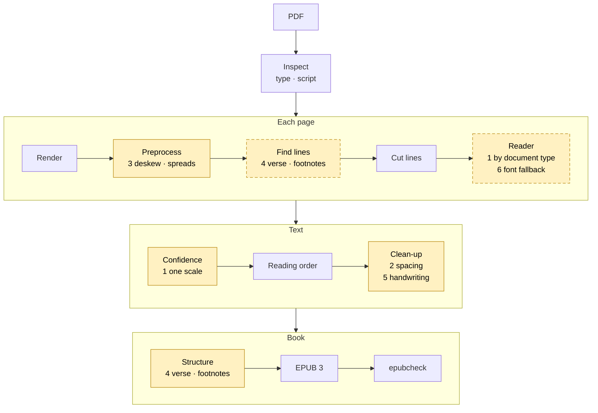
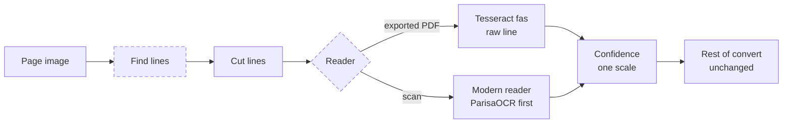

# rtlbook roadmap

What's next for the engine. [DESIGN.md](DESIGN.md) describes what is built and why; this file holds what isn't
built yet. When an item ships, its design goes into DESIGN.md and the item is removed from here, so the two
never overlap. Like DESIGN.md, this is about the engine only.

## 1. Phases

Support grows one document type at a time (DESIGN.md §1); each phase is finished, with measured accuracy, before
the next.

| Phase | Scope | Done when |
|---|---|---|
| **1: Exported PDFs, prose** (current) | OCR every page ✅, - document type in `inspect` ✅, low-confidence warning ✅, title pages / TOC pages kept out of the text ✅, Latin footers kept out of the text, chapters ✅, title and author ✅, an exported-PDF regression test ✅ | Every exported prose book converts to an EPUB you'd read without noticing errors, with measured accuracy on sample pages |
| **2: Publishable output** | Front matter, the book's own TOC, footnotes, half-space normalization; checked in Thorium Reader (Readium) | One complete book you'd happily recommend |
| **3: Scans of modern print, then verse** | Deskew, spreads, low-resolution warnings; couplets laid out as verse in the EPUB | Measured accuracy on scanned pages; verse reads correctly |
| **4: Old letterpress** | A modern reader for scans in the reader slot (see the first work item); a second reading (opt-in AI vision), a review step for disagreements | A 1930s book converts with errors only a review can catch |
| Later | Typewriter, other languages | — |

## 2. Work items

Where the engine is weakest, in the order to work on it (2026-10-14):
1. **The reader on scans** (next item): about ten times more letters wrong than a modern reader.
2. **Spacing:** half-spaces and spaces between words (text clean-up, below); every book, exported PDFs too.
3. **Scan preprocessing:** deskew, spreads, uneven backgrounds, low resolution (below).
4. **Layout:** two-column verse with a narrow gutter (~46% of words found), footnotes, bold titles.
5. **Readers' marks in scans** (below).
6. **Unusual fonts** (below).

Line finding, text clean-up, structure, the EPUB builder and validation hold up; they wait until the letters are right.

Yellow: a change planned, numbered as the list above; dashed: a slot, where parts can be swapped. Plain: built and
holding up (DESIGN.md §3).

### Reader slot and scorecard — current focus (2026-10-14)
- **Problem:** Tesseract's `fas` model caps accuracy on scans: 6–14% of letters wrong on 1932 letterpress. The
  model shrinks each line to 48 pixels high, where the dots that tell ب ت ن ی apart are a pixel or two, and it was
  trained on text rendered in computer fonts (`synth20170629`). Retraining doesn't lift the cap: `fas_print` (`fas`
  fine-tuned on Persian print, tessdata_contrib) still misreads 7–12% of the same lines. On the very line images
  rtlbook cuts, ParisaOCR's model (Apache-2.0; PaddleOCR's PP-OCRv6 recognizer design run by Kraken, 3.1M
  parameters, lines 96 pixels high) misreads 1.3%. Line finding isn't the limit; the reader is.
- **Goal:** the reader chosen by document type: Tesseract for exported PDFs (0.5–0.8%, 1–2 s a page), a modern
  reader for scans; every change measured on the scorecard before it ships.
- **Where it leads** (DESIGN.md §3 has today's pipeline):

  Dashed: a slot, where parts can be swapped (find lines: Tesseract today, Kraken or PaddleOCR later for verse and
  footnotes; the scan reader: trained further on checked lines later). The scorecard measures every change to one.
- **Approach:**
  1. *Scorecard* (`make bench`): fixed public-domain cases, one number per weak spot, saved per engine version so
     changes compare:
     - the reader alone: the 1932 book's checked test lines as fixed line images; letters wrong;
     - whole pages (line finding + reader + reading order): the same book's five test pages; letters wrong, lines
       lost or merged;
     - spacing, counted apart from letters: spaces and half-spaces;
     - the exported PDF in `tests/data/tomorrow/`: must not get worse;
     - speed and size: seconds a page, memory, image size.

     A case joins when work on its weak spot starts (1960s type, two-column verse), not before.
     **Built (2026-10-14):** `rtlbook bench`, `make bench SET=…`, results in `bench/results.jsonl`. Tesseract's
     baseline on 54 checked test lines and 3 whole pages of the 1932 book: 6.4% letters wrong reading each line
     alone, 13.3% of word gaps wrong; whole pages 7.0%; the exported PDF 0.52%; 0.05 s a line, 1.3 s a page.
  2. *Reader slot:* Tesseract finds the lines (and column gaps), rtlbook cuts each line image, the reader returns
     its text and confidence (today all of it is one Tesseract call, `ocr.ocr_lines`). First with only Tesseract
     behind it. The reader joins the OCR cache key. `readers.py` has the slot, used by the scorecard so far.
     Found on the way: Tesseract reading a cut line as a raw line (`--psm 13`) misreads 6.4% of the test lines'
     letters, against 9.6% when it reads the whole page (and 19.8% with `--psm 7`), so the slot may be a gain
     with Tesseract alone: the whole-page row will tell.
  3. *ParisaOCR as the scan reader:* speed (its own converter took ~12 s a page against Tesseract's 1–2), image
     size (it ships with PyTorch; ONNX Runtime is likely far smaller), its own confidence scale (the warning below
     70, headings at 60 and `--min-line-conf` are tuned to Tesseract's), and which clean-up fixes aimed at
     Tesseract's habits (`»` for the Persian comma, `!` read as `ا`) still help.
  4. *Later:* continue training the scan reader on checked lines (Kraken's tools); a second slot for line finding
     (Kraken's segmenter, PaddleOCR's layout model) with verse and footnotes; Calamari as another trainable reader
     to measure. Swappable parts, not a plugin framework: a few built-in choices per slot, kept only when they win.
- **Not used:** parts under AGPL or with restricted weights (YOLO-based layout models, Surya); readers measured
  weaker on this type (Hezar's CRNN, 38.6%).
- **Open:** ParisaOCR isn't measured on 1960s type yet, where Kraken's stock Persian model misread 20–30%.

### Letterpress type (1930s–60s) — training set in progress (ahead of phases 3–4)
- **Problem:** Tesseract misreads 6–12% of letters on a 1963 poetry printing and 6–8% on a 1932 prose printing
  (two hand-checked pages each). Most errors are dots (ی→ب, ن→ت, پ→د), گ read as ک, bold titles garbled, and specks
  read as characters. Kraken's stock Persian model does worse on the 1963 type (20–30%), better on the 1932 (2%).
- **Goal:** checked lines of old type: the test set the scorecard measures readers with, and later the data to
  fine-tune the scan reader on (not Tesseract: see the item above).
- **Approach:**
  1. *Line transcription page:* the review page (DESIGN.md §6) for whole lines: the line image, the OCR text
     filled in, and uncertain words (low confidence, or not in a word list) highlighted with suggestions. Its
     output is both ground truth and training data.
  2. *Dot-aware word suggestions:* for a word that isn't in the word list, real words with the same letter shapes
     but other dots (ب پ ت ث ن ی, ج چ ح خ, د ذ, ر ز ژ, س ش, ک گ, …), ranked by how often they occur elsewhere in
     the book. Offered on the review page, not applied automatically, until measured.
  3. *Fine-tuned Tesseract model, dropped (2026-10-14):* Tesseract's model caps the gain (`fas_print`, fine-tuned
     on more lines than one book has, still misreads 7–12%). The checked lines measure readers instead, and train
     a modern one later. Training lines are scans and never go into git; only a model might ship.
- **Not covered here:** layout (next item).
- **Trial (2026-10-07):** the line transcription page was tried on the 1963 printing: 349 lines decided, 324 of
  them checked. The data was then dropped for a clean start; the lessons were kept: settle the rules (with real
  examples) before checking; a routine second look at lines that differ most from OCR (it changed 12 of 21); crops
  must include marks at line edges; keep an append-only history of decisions.
- **Next:** a clean start on a book that is public domain everywhere, the 1932 Hedayat printing in `tests/data/`
  (1930s type; a 1960s book follows). Its lines are checked in a separate tool that reads the set from the private
  bucket (push and pull, [TRAINING-DATA.md](TRAINING-DATA.md)).

### Verse layout (phase 3)
- Free verse: keep one printed line per line instead of joining lines into prose paragraphs.
- A wide word gap inside one verse line is sometimes split as a column gap; the split should only fire on real
  two-column verse.
- Couplets laid out as verse in the EPUB.

### Readers' marks in scans (open)
- **Problem:** scans of library copies carry earlier readers' handwriting: notes in the margins and between
  lines, underlining, arrows. OCR reads it as Persian-looking nonsense words inside the lines of text, and a note
  written over printed words damages them too. Seen on a 1963 poetry printing (a page of glosses) and in a 1925
  Masnavi scan (pencil notes). Nothing in the pipeline catches it today.
- **Goal:** no handwriting reaches the book as text. Where printed words are lost under it, the book shows a
  visible gap marker instead of a guess or nonsense, the way printed editions mark an unreadable word.
- **Approach (to investigate):**
  1. *Drop margin notes:* printed lines share column edges across the book; words beyond those edges with low
     confidence are notes, not text.
  2. *Mark damaged words:* a word with very low confidence inside an otherwise good line becomes a marker in the
     EPUB (for example `[ناخوانا]`, "illegible"), styled so readers see something is missing. The threshold is
     measured on checked pages so real words aren't replaced.
  3. *Report the pages:* list pages that look marked up in `report.json`, so a person can check them.
  4. *Recover from the print, never from the handwriting:* a note is a reader's gloss or "correction", not the
     printed text. A lost word is filled in only from another source of the same text: a clean scan of another
     copy of the same printing (which rtlbook could OCR and use for just the damaged spots), or else a later
     edition, recorded as such. Until then the gap marker stays.
- **Measure:** on checked pages from both books, nonsense words that reach the text and real words wrongly
  dropped or marked.

### Unusual fonts (open)
Decorative fonts defeat Tesseract. `convert` warns (mean confidence below 70) but has no fallback. Findings on one
book (a handwriting-style font, confidence 55): no Tesseract setting helped (resolution, binarization,
`ara`/`fas+ara`, `--psm 6`: word recall 37–45%); the PDF's own stored text, rebuilt from character positions, had
**every letter right** but stray spaces inside about 1 word in 5. Options: an opt-in text-layer fallback (perfect
letters, spacing glitches, brings back per-PDF rules), or opt-in AI vision. Deferred to keep the pipeline simple.

### Planned, by stage
- **Input:** a folder of page images instead of a PDF, for scans: old books are often only available as page
  images (dropped 2026-10-06, DESIGN.md §4.2).
- **Preprocessing (scans):** deskew, two-page spread splitting (right-hand page first), denoise, adaptive
  binarization, low-resolution warnings.
- **Layout:** footnotes, page furniture in Latin script, multi-column prose.
- **OCR engines (phase 4):** the reader slot is now the current focus (above). Still planned: choose the engine per book
  from a reviewed sample page; where two engines disagree, a person decides on the review page. An AI vision
  engine would send page images to an outside service: opt-in only, never the default.
- **Document model:** block types (footnote, verse, table), printed page labels.
- **Text clean-up:** half-space (ZWNJ) normalization (`می گویم` → `می‌گویم`); in some bold fonts `!` without a
  following space OCRs as `ا` and merges words, fixable with corpus word statistics.
- **AI correction (opt-in):** correct low-confidence lines with a vision model, compared back to the OCR output;
  large edits are flagged, not accepted. Off by default.
- **Structure:** footnotes (`noteref` → `footnote`); couplets laid out as verse.
- **Review page:** reviewing disagreements between two OCR engines; proofreading a whole book.
- **Readers:** check the EPUBs in Thorium Reader (Readium) and fix what renders wrong there: page direction, the
  embedded font, the page list, the TOC.

## 3. Later
- Typewritten books (none found yet).
- Arabic, Urdu and Hebrew, as configuration where possible.
- Side outputs: searchable PDF, Markdown/HTML/DOCX, hOCR/ALTO; fixed-layout EPUB as a fallback where reflow fails.
- Narrated EPUBs (EPUB 3 media overlays): audio synced to the text, sentence by sentence, so the book reads aloud
  with the text highlighted even where the device has no Farsi voice (Thorium plays them). The audio comes from a
  Farsi TTS voice (Azure's neural voices) or aligned from a recording. Farsi doesn't write short vowels or the
  ezafe, so a voice misreads some words; verse needs vowel marks or a pronunciation list. Try first: DAISY
  Pipeline 2's EPUB 3 enhancer (TTS), Storyteller (aligns a recording with Whisper).
